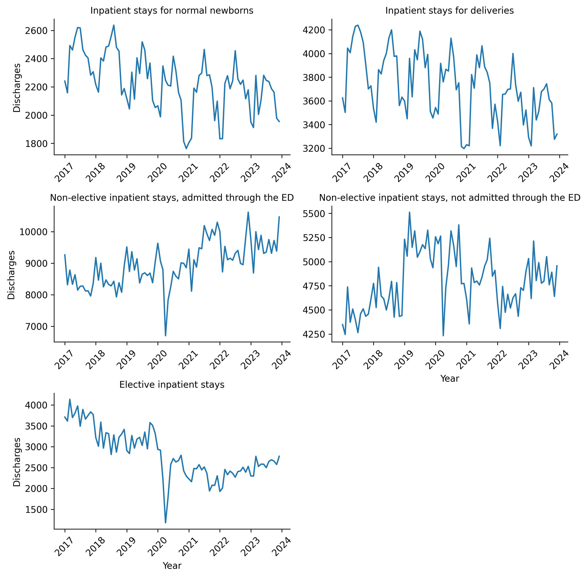
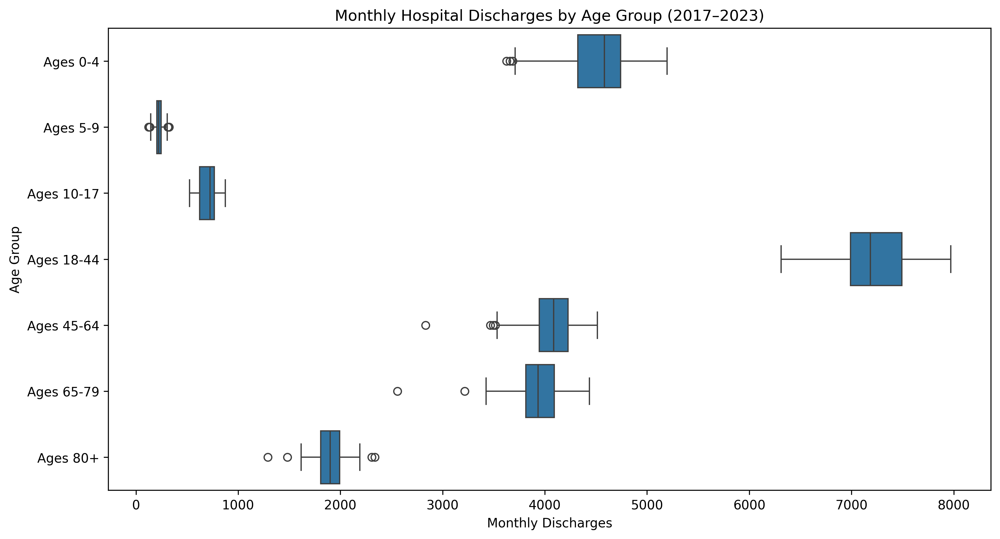
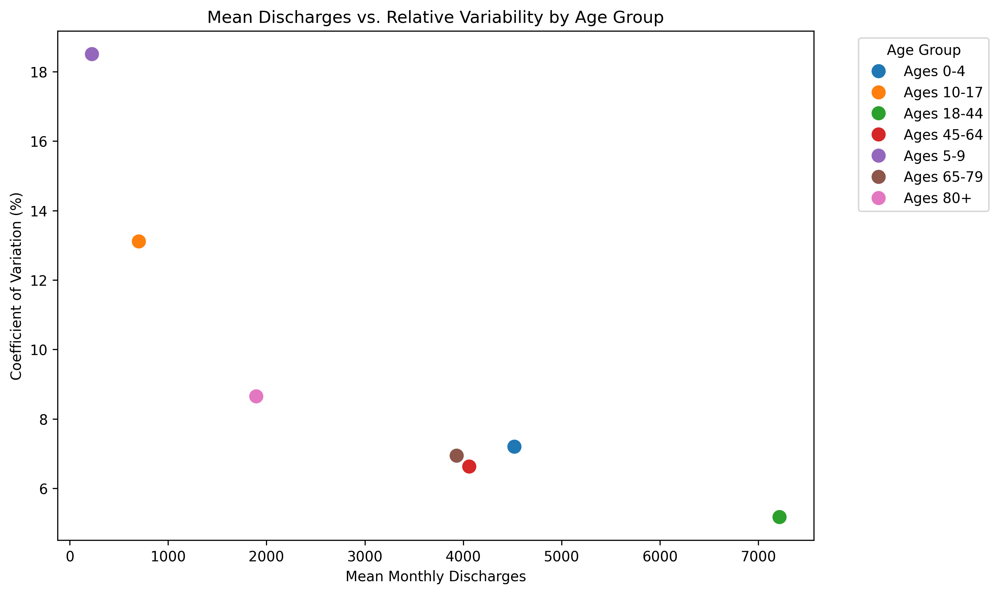
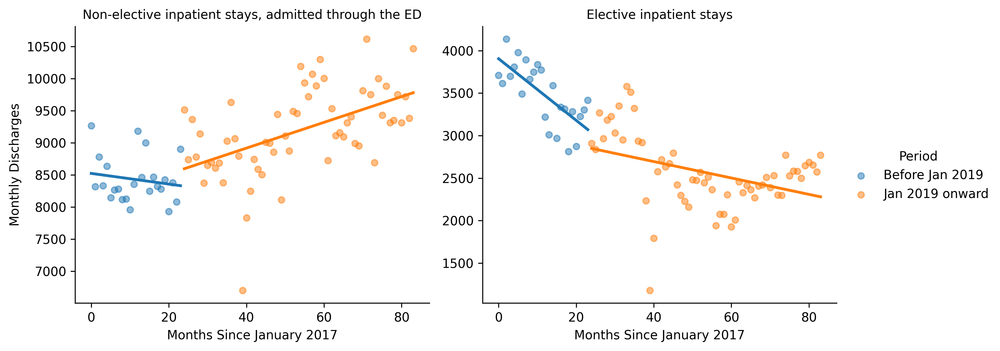

# utah-hospital-discharge-analysis
## Project Overview

For my final Python project, I analyzed Utah hospital discharge data to identify patterns and trends in hospital utilization.
I previously used this dataset for my Excel final project and expanded my analysis utilizing Python.

 
## Dataset
My data comes from the Healthcare Cost and Utilization Project (HCUP), specifically the Utah State Inpatient Databases (SID) summary trend tables.

Dataset source: https://catalog.data.gov/dataset/healthcare-cost-and-utilization-project-hcup-summary-trends-tables?from_hint=eyJxIjoiaGN1cCIsInNvcnQiOiJyZWxldmFuY2UifQ%3D%3D

## Project Goals

The goal of this project was to analyze monthly Utah hospital discharge patterns from January 2017 through December 2023 using Python.

The analysis focused on the following questions:

How did hospital discharge trends differ across encounter types?

What changes were observable around January 2019 and during the COVID-19 pandemic?

How did monthly discharge volumes and variability differ across age groups?

What did descriptive statistics and linear regression reveal about these patterns?

## Tools and Technologies

Python, 
Google Colab,
Pandas,
NumPy,
Matplotlib,
Seaborn

## Methodology

Data Cleaning and Preparation:

The Excel dataset was imported into Google Colab using Pandas. The data was inspected for missing values, duplicate records, and formatting issues. Relevant rows and columns were selected, discharge counts were converted to numeric values, and monthly reporting dates were converted to datetime format. The analysis focused on January 2017 through December 2023.

Data Manipulation:

The dataset was filtered to isolate encounter types and age groups relevant to the research questions. Wide-format monthly data was reshaped into long format using pd.melt() to facilitate visualization and analysis. Data was also grouped by age category to calculate summary statistics.

Data Visualization:

Four visualizations were created using Matplotlib and Seaborn:

Line graphs illustrating monthly discharge trends across five encounter types.

Box plots comparing the distributions of monthly discharges across seven age groups.

A scatter plot comparing mean monthly discharges with the coefficient of variation (CV) for each age group.

Linear regression plots comparing elective inpatient stays and non-elective inpatient stays admitted through the emergency department (ED), before and after January 2019.

Statistical Analysis:

Descriptive statistics, including mean, standard deviation, and coefficient of variation, were calculated to compare discharge volumes and variability across age groups.

Linear regression was used to examine trends in two encounter types across two reporting periods. Regression slopes and R² values were calculated to describe the direction of discharge trends and how much variation was explained by each linear model.

Key Findings:

Encounter trends: Hospital discharge patterns differed across encounter types. Elective inpatient stays generally declined, while non-elective inpatient stays admitted through the ED showed an overall upward trend in the later reporting period. Several encounter types exhibited substantial declines during 2020, coinciding with the COVID-19 pandemic.

Age-group distributions: Adults ages 18–44 had the highest average monthly discharge volume. However, age categories covered different numbers of years, so raw discharge counts should not be interpreted as age-specific hospitalization rates.

Relative variability: Ages 5–9 demonstrated the highest coefficient of variation (18.50%), despite having the lowest average monthly discharge count. Ages 18–44 had the lowest coefficient of variation (5.17%), indicating comparatively stable monthly discharge volumes relative to their mean.

Regression results: Elective inpatient stays declined in both reporting periods, although the decline was steeper before January 2019. Non-elective inpatient stays admitted through the ED showed a weak downward trend before January 2019 and an upward trend afterward.

Limitations:

These findings describe observed patterns and associations rather than establishing causation. Changes in reporting practices, healthcare utilization, population characteristics, and the COVID-19 pandemic may have influenced the results. Further analysis would be necessary to determine their individual contributions.

## Project Visualizations

### 1. Hospital Discharge Trends by Encounter Type

### 2. Monthly Hospital Discharges by Age Group

### 3. Mean Monthly Discharges and Coefficient of Variation

### 4. Linear Regression of Hospital Discharge Trends

